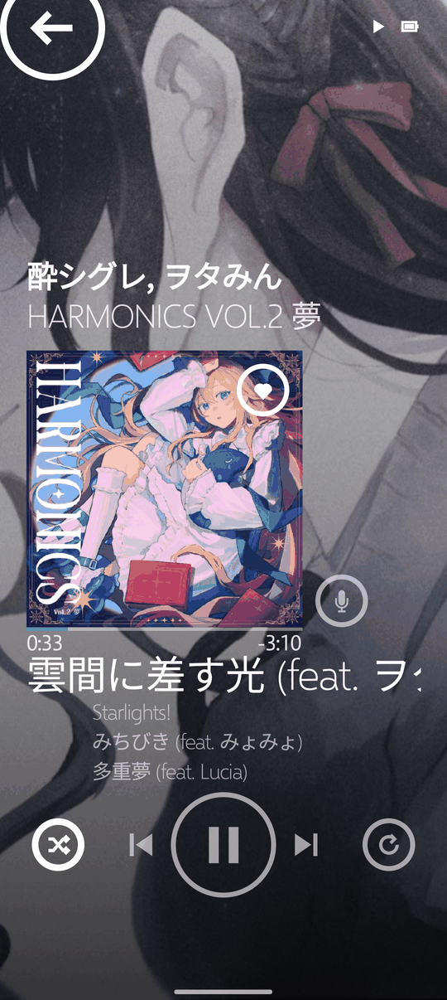
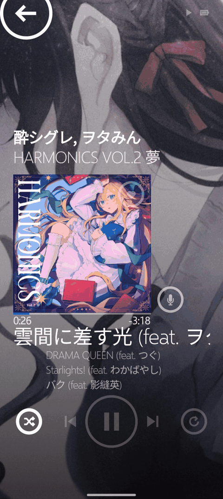
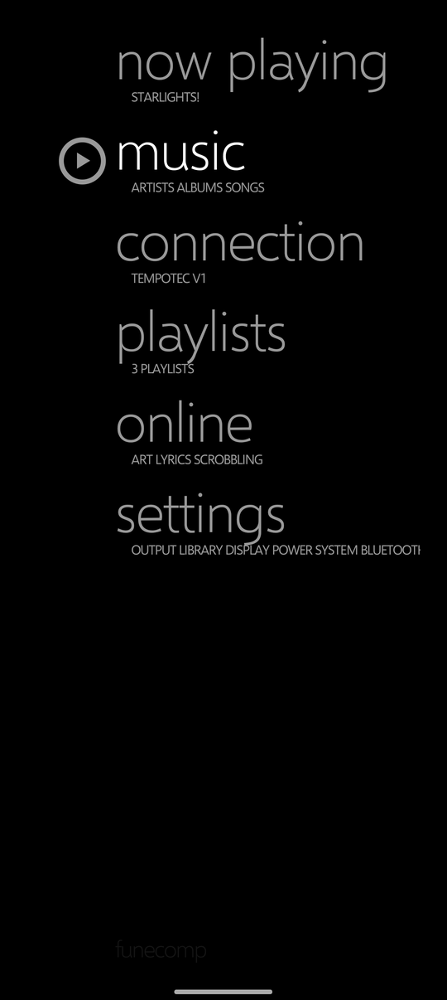
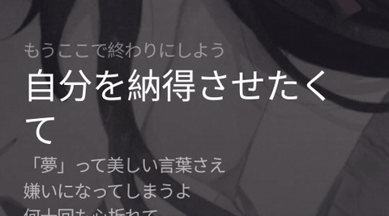
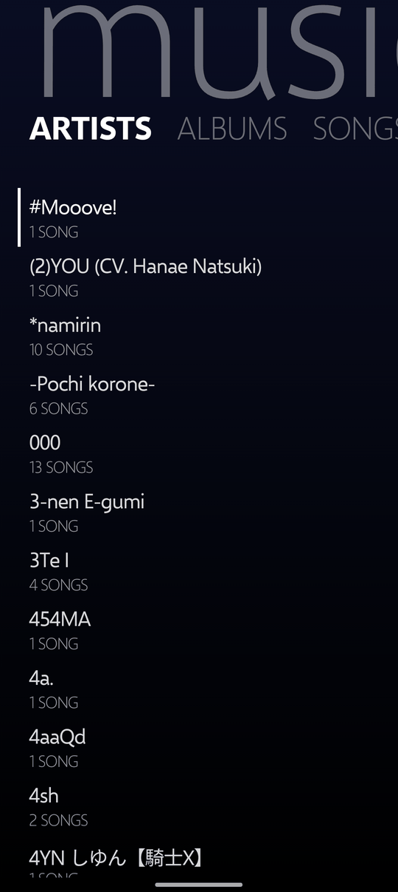
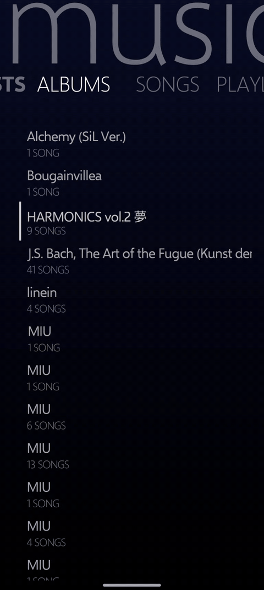
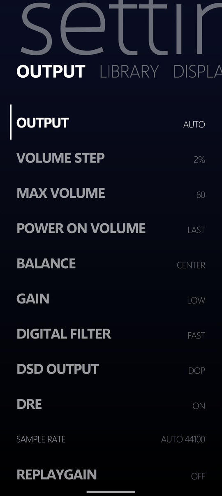
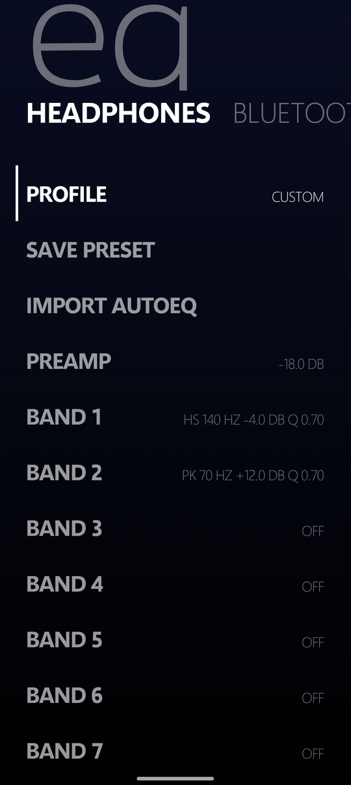
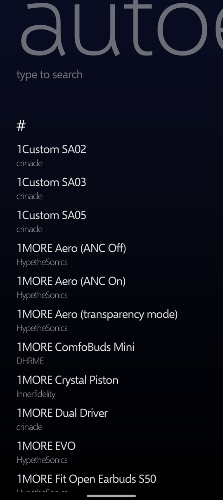
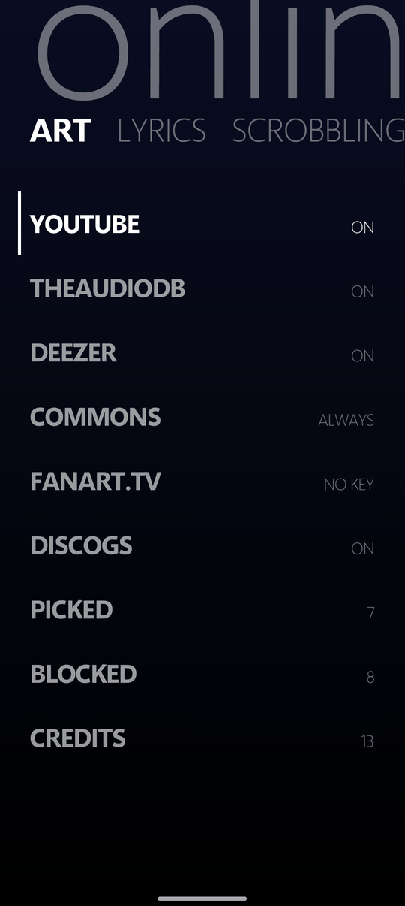

# funeCOMP

Android remote for [funeOS](https://github.com/seilent/funeos) on the Hidizs AP80 and TempoTec V1, over Bluetooth.
Playback, volume, queue, library, settings and EQ from the phone. Artist photos are fetched on the phone and pushed to
the device as the Now Playing backdrop.

<p>



</p>



<p>




</p>

<p>


</p>

## Setup

1. On the device: Settings > System > PHONE APP on, then PAIR PHONE APP.
2. Pair the phone from its Bluetooth settings and confirm the code on both screens.
3. Open funeCOMP: it shows Connection until the device is linked. Pick the device under DEVICE.

Artist art sources (TheAudioDB, fanart.tv with a key, YouTube, Discogs, Wikimedia Commons, Deezer) and lyrics sources (LRCLIB, NetEase) are on by default: Home > Online.

Android 12 or newer.

## Build

```
./gradlew assembleRelease
```

Release signing reads `app/keystores/keystore.properties` (`storeFile`, `storePassword`, `keyAlias`, `keyPassword`);
without it the release APK is unsigned. Last.fm scrobbling reads `app/keystores/lastfm.properties` (`lastfm.key`,
`lastfm.secret`); without it, build with `-PnoLastFm`.

## License

GPL-3.0-or-later. Selawik is under the SIL Open Font License 1.1 (`app/src/main/assets/OFL-Selawik.txt`).
